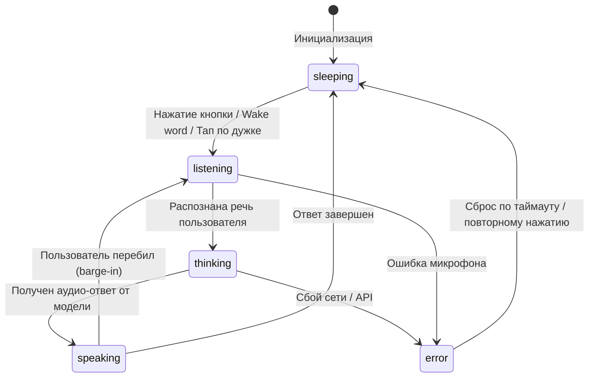

# Архитектура системы: Jarvis Glasses Assistant

## 1. Концепция и назначение
Jarvis — персональный голосовой AI-ассистент, оптимизированный для работы через умные очки (AI Glasses) и гарнитуры.
Ключевые приоритеты:
- Минимальная задержка аудио (Low Latency Audio, < 800 ms TTFT/TTFB).
- Управление голосом без рук (Hands-Free) и тактильными тапами по дужке.
- Безопасность: разделение прав, Human-in-the-Loop подтверждение опасных операций, отсутствие секретов на клиенте.

---

## 2. Архитектурная схема (Веб-прототип)

```
[ AI-очки / Смартфон ]
       │  (Микрофон / Динамик, Touch Tap)
       ▼
[ T01: Mobile Web Client ]
       │  ├── State Machine (sleeping / listening / thinking / speaking / error)
       │  ├── Audio I/O Manager (Web Audio API / MediaDevices)
       │  └── WebSocket Client (PCM 16kHz / 24kHz)
       │
       ▼ (WSS / Двусторонний аудиострим)
[ T02: Gateway / Proxy Server ]
       │  ├── Auth & Session Management
       │  ├── Tool Calling Router
       │  └── Audio Codec Converter (PCM <-> Gemini format)
       │
       ├───► [ T03: Gemini Live Multimodal API ]
       │        ├── Real-time Voice to Voice
       │        └── Function Calls Trigger
       │
       └───► [ T05: Tools & System Handlers ]
                ├── Статусы системы / устройств
                ├── T04: База знаний I CLUB
                └── Очередь задач (Этап 2)
```

---

## 3. Машина состояний (FSM)



---

## 4. Спецификация инструментов (Tool Calling Specs)

Инструменты регистрируются в сессии Gemini Live и вызываются моделью декларативно.
Клиент или сервер выполняет их и возвращает результат в сессию.

- **`get_system_status`**: Получение уровня заряда, сетевого подключения, режима работы.
- **`query_iclub_knowledge`**: Поиск по регламентам, участникам, расписанию и структуре I CLUB.
- **`get_active_tasks`**: Чтение текущих фоновых задач и напоминаний.

---

## 5. Требования к безопасности
- Клиентская часть не содержит API-ключей и сервисных токенов.
- Конфигурация вынесена в `.env`, доступ к которой имеет только backend/proxy.
- Все деструктивные или критические действия требуют явного голосового или тактильного подтверждения («Вы уверены, что хотите отправить...?»).
